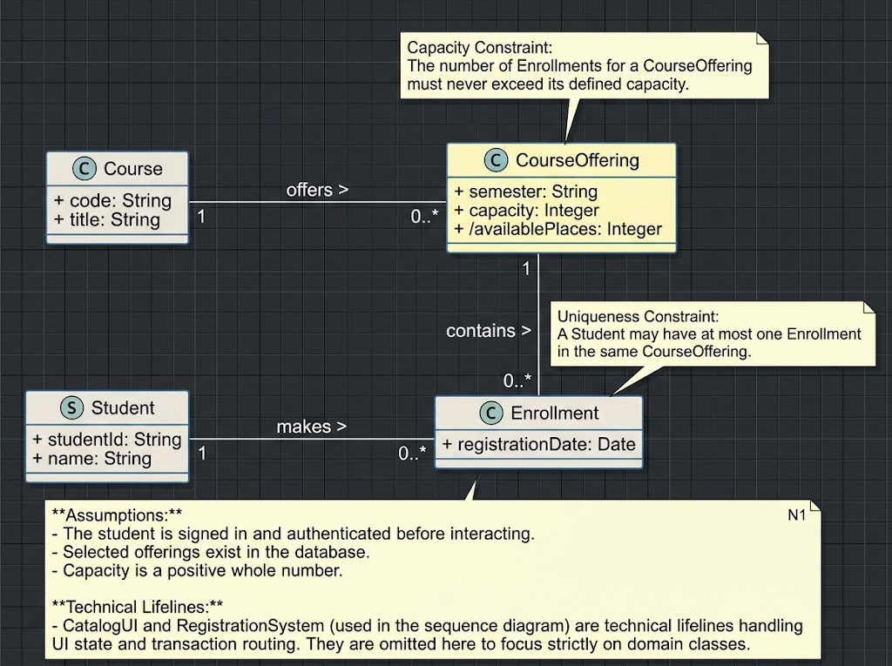
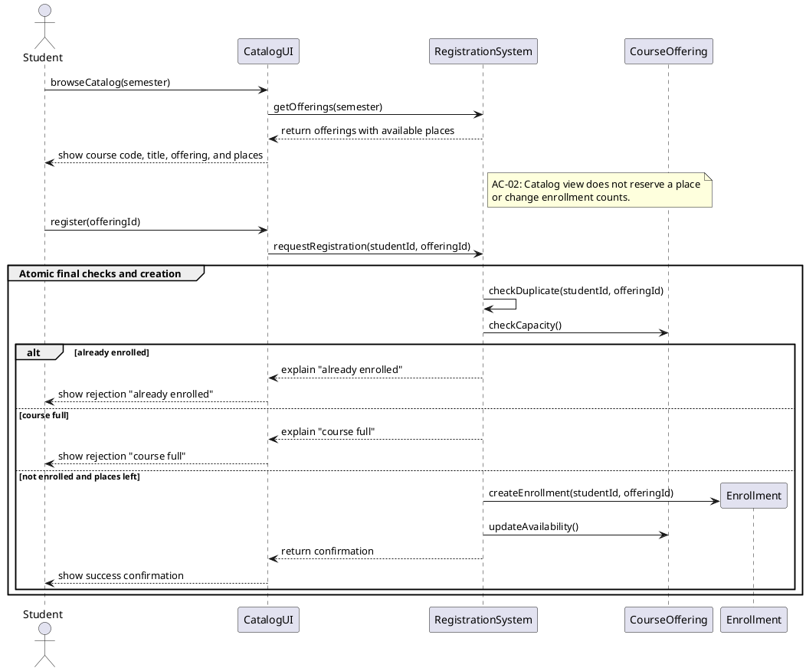
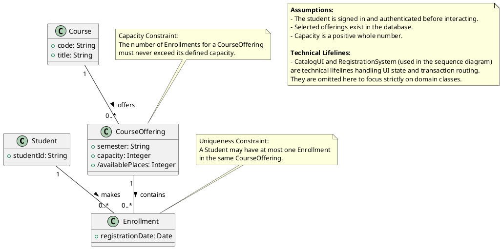
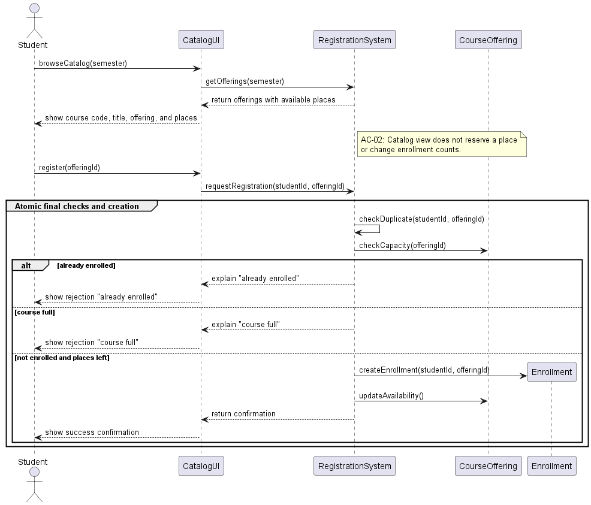

# SIS #02 — AI-Assisted UML Modeling: University Course Registration

<!--
  This is the only file you write your report in. README.md tells you what goes where.

  Rules the checker relies on:
  - Do not delete, rename or renumber the ## headings, the ### headings, or the **Label:** words.
  - Replace every "(write here)" and "(paste here)". None may be left when you submit.
  - Comments like this one are ignored by the checker and the word counter. Delete them or leave them.
-->

## 1. Scope and assumptions

**Scope:** This system allows a student to browse an electronic course catalog for a semester, check available places, and register for a specific course offering while preventing duplicate enrollments. Payments, prerequisites, timetable clashes, waiting lists, and cancellation are out of scope.

**Assumptions:**

1. The student is signed in and authenticated.
2. The selected course offering exists in the database.
3. The total capacity of an offering is a positive whole number.

## 2. User stories and acceptance criteria

<!-- Your APPROVED requirements: Prompt A's draft after your review. Keep the IDs, the three
     story headings and the bullet shape. Every criterion names the rule(s) it maps to,
     e.g. (R2, R4). Two criteria per story. Nothing out of scope.
     Format of a criterion, on one bullet:
     - **AC-03** (R2, R4): Given ..., When ..., Then ... -->

### US-01 — Browse offerings

**US-01:** As a student, I want to browse the electronic course catalog for a semester so that I can see the available subjects and how many places are left.

- **AC-01** [R1]: Given the student is viewing the catalog for a specific semester, When the page loads, Then the system shows the course code, title, offering, and available places.
- **AC-02** (R?): [Scenario, R5]: Given a student is viewing the catalog, When they see available places for an offering, Then the system does not reserve a place or change the enrollment count until a registration request is explicitly made.

### US-02 — Register for an offering

**US-02:** As a student, I want to register for a specific course offering so that I can secure an available place in the class.

- **AC-03** [R2, R4]: Given the student is not currently enrolled in the selected offering and its current availability is greater than zero, When the student requests registration, Then the system creates exactly one Enrollment linking the student and offering, updates the available places, and returns a confirmation.
- **AC-04** [Scenario, R2]: Given a course offering has exactly one place remaining, When the student requests registration, Then the system executes the final availability check and enrollment creation as one atomic operation to ensure the capacity is never exceeded.

### US-03 — Receive a clear rejection

**US-03:** As a student, I want to receive clear feedback if my registration fails so that I know why I was not enrolled.

- **AC-05** [R2, R5]: Given the current availability of the selected course offering is zero, When the student requests registration, Then the system explains "course full", creates no enrollment, and leaves the enrollment count unchanged.
- **AC-06** [R3, R5]: Given the student already has an existing enrollment in the selected course offering, When the student requests registration for that same offering, Then the system explains "already enrolled", creates no enrollment, and leaves the enrollment count unchanged.

## 3. Sequence diagram


**Participants:** `Student` (the actor interacting with the system), `CatalogUI` (the user interface displaying the catalog), `RegistrationSystem` (the backend controller managing the business logic), `CourseOffering` (the domain entity representing the scheduled class section), `Enrollment` (the domain entity linking a student to an offering).

**Atomic operation:** The `checkDuplicate`, `checkCapacity`, and `createEnrollment` messages are grouped into one atomic block. This ensures that no other student can take the last place while the current request is being processed. The catalog view reserves nothing because it only reads the current state without placing locks on the database.

**Where the Enrollment is created:** The `Enrollment` is created by the `RegistrationSystem` lifeline using the `createEnrollment(studentId, offeringId)` message, which produces the `Enrollment` instance shown in the class diagram.

**Technical lifelines:** `CatalogUI` and `RegistrationSystem`. These represent presentation and controller logic. The difference in abstraction is fine because technical lifelines coordinate the transaction in the sequence diagram, while the class diagram strictly models the pure business domain entities.

## 4. Class diagram



| Association | Read left to right | Read right to left |
| --- | --- | --- |
| Course "1" -- "0..*" CourseOffering | A Course offers zero or more CourseOfferings. | A CourseOffering is offered by exactly one Course. |
| Student "1" -- "0..*" Enrollment | A Student makes zero or more Enrollments. | An Enrollment is made by exactly one Student. |
| CourseOffering "1" -- "0..*" Enrollment | A CourseOffering contains zero or more Enrollments. | An Enrollment is contained in exactly one CourseOffering. |

**How an Enrollment links a student to an offering:** An Enrollment acts as an associative entity that connects exactly one Student identifier with exactly one CourseOffering instance at a specific registration date.

**Capacity constraint:** The number of Enrollments for a CourseOffering must never exceed its capacity. Multiplicity alone (`0..*`) only states there can be many enrollments; it cannot enforce a dynamic numerical limit based on the offering's `capacity` attribute.

**Uniqueness constraint:** A Student may have at most one Enrollment in the same CourseOffering. Multiplicity (`0..*`) allows a student to have multiple enrollments across the system, but does not inherently restrict them from registering for the *same* offering multiple times without a constraint note.

## 5. Traceability

| Rule and criterion | Model evidence | Validation case |
| --- | --- | --- |
| R1 + AC-01 | `return offerings with available places` message and UI display | Checked manually via diagram inspection. |
| R2 + AC-03, AC-04 | `checkCapacity()` message, `else course full` guard, and Capacity Constraint note | T2, T3 |
| R3 + AC-06 | `checkDuplicate` message, `alt already enrolled` guard, and Uniqueness Constraint note | T4 |
| R4 + AC-03 | `createEnrollment` message and `updateAvailability()` message | T1, T2 |
| R5 + AC-02, AC-05, AC-06 | `explain "already enrolled"`, `explain "course full"` return messages with no creation steps | T3, T4 |

## 6. Walkthroughs

| Case | Observed path and state change | Judgment and evidence |
| --- | --- | --- |
| T1. Available | `browseCatalog` -> `register` -> `Atomic group` -> `checkDuplicate` -> `checkCapacity` -> `createEnrollment` -> `updateAvailability`. Enrollment count changes from 0 to 1, successfully taking one available place. | Pass. Location: `else not enrolled and places left` guard and `createEnrollment` message. |
| T2. Last place | `register` -> `Atomic group` -> `checkDuplicate` -> `checkCapacity` -> `createEnrollment` -> `updateAvailability`. Enrollment count changes from 1 to 2, leaving exactly zero places remaining. | Pass. Location: `group Atomic final checks and creation` boundary and `createEnrollment`. |
| T3. Full | `browseCatalog` -> `register` -> `Atomic group` -> `checkDuplicate` -> `checkCapacity` -> `explain "course full"`. The enrollment count remains exactly at 2 because the course is completely full. | Pass. Location: `else course full` guard and `explain "course full"` message. |
| T4. Duplicate | `register` -> `Atomic group` -> `checkDuplicate` -> `explain "already enrolled"`. The enrollment count remains exactly at 1 because the request is rejected as a duplicate. | Pass. Location: `alt already enrolled` guard and `explain "already enrolled"` message. |

## 7. Review decisions

<!-- At least three substantive decisions about Prompt C's critique or your own inspection.
     Decision: accepted / rejected / modified — and what you did. Reason: why, in a full
     sentence. Rule: R1–R5. Do not invent an error to fill the table; a justified rejection
     of advice counts. -->

| AI suggestion or model element | Decision | Reason | Rule |
| --- | --- | --- | --- |
| Sequence diagram, message `checkCapacity(offeringId)` sent to `Offering`. | Accepted | Passing the ID to a specific offering instance is redundant and must be removed. | R2 |
| Class diagram, attribute `availablePlaces` in the `CourseOffering` class. | Accepted | It can be calculated dynamically from capacity and enrollments, so it needs a slash. | R2 |
| Sequence diagram, creating enrollment with IDs: `createEnrollment(studentId, offeringId)`. | Rejected | Passing whole object references instead of IDs is unnecessary for this sequence abstraction level. | R4 |

## 8. Modeling explanation

In this assignment, I designed a university course registration system using PlantUML. The main design choice was to separate the presentation and control logic from the domain models. The sequence diagram introduces `CatalogUI` and `RegistrationSystem` as technical lifelines to handle user requests and enforce atomic transactions. This separation of concerns ensures that domain classes (`Student`, `Course`, `CourseOffering`, `Enrollment`) remain pure and focused solely on business rules and data structures, which is why the technical lifelines are intentionally omitted from the class diagram.

The sequence and class diagrams complement each other by representing the dynamic and static views of the system. The class diagram defines the structural blueprint, showing how a `Student` is linked to a `CourseOffering` via an `Enrollment`, and explicitly defining attributes like the derived `/availablePlaces`. The sequence diagram brings this structure to life, demonstrating the exact chronological order of method calls required to instantiate that `Enrollment` while respecting the capacity and uniqueness constraints defined in the class diagram notes.

While these diagrams effectively capture structure and message passing, an activity diagram could also help explain the workflow. An activity diagram would be highly beneficial for visualizing the complex decision-making process during registration. It would provide a clear, flowchart-like view of the parallel checks, the atomic lock boundaries, and the specific branching logic (e.g., checking duplicates versus capacity) that leads to either a successful registration or a clear rejection, making the business workflow more accessible to non-technical stakeholders.

## 9. Reflection

Throughout this assignment, the AI assistant was incredibly helpful in rapidly generating the initial PlantUML syntax from my plain-text requirements. It accurately mapped the user stories into a structurally sound sequence diagram and correctly applied UML associations in the class diagram. 

However, the AI's initial output was not perfect. One decision I made myself was to reject the AI's suggestion to pass entire object references in the sequence diagram's `createEnrollment` message. I recognized that at this level of system interaction, passing primitive identifiers (`studentId`, `offeringId`) is more realistic for a system controller routing data to a database, and changing it would needlessly complicate the diagram.

One remaining limitation of using AI for UML modeling is its struggle with complex domain constraints. While it can draw basic relationships, it often fails to natively encode dynamic business rules (like "capacity cannot be exceeded") into standard UML multiplicities, requiring me to manually prompt it to add explanatory notes. The AI understands syntax perfectly, but human oversight is still strictly required to ensure the architectural semantics align with the specific business reality of the scenario.

## 10. Appendix A — Before AI

<!-- Written BEFORE you run Prompt A, committed and pushed in your first commit, and never
     edited afterwards. This is what you paste into Prompt A as "My initial assumptions". -->

**Scope:** (write here)

**Initial assumptions:**

1. (write here)
2. (write here)

## 11. Appendix B — AI exchanges

<!-- Complete prompts and complete responses, as text — never screenshots. Paste each inside
     the ~~~~ block that follows its label: AI responses contain ``` PlantUML blocks, and
     ~~~~ keeps them from breaking this file. Prompts B and C: the prompt text first, then
     the material it refers to ("below", "these two") pasted under it, in the same block.
     You may add B5, B6 … after B4 if you ran more. -->

### B1 — Requirements (Prompt A)

- **Tool:** (write here)
- **Model:** (write here)
- **Date:** (write here)
- **Purpose:** draft 3 user stories and 6 acceptance criteria

<!-- Model: the exact model with its version, as the tool shows it (e.g. "GPT-5 Thinking",
     "Claude Sonnet 4.5"). If the tool does not show it, write: not displayed
     Date: YYYY-MM-DD -->

**Prompt:**

Act as a requirements analyst. Use only this course registration scenario and rules R1–R5: A student browses an electronic course catalog, chooses a course offering and requests registration. Each offering has a limited number of places. A Course describes a subject. A Course Offering is one scheduled section in one semester. Registration always targets a specific offering. Assume that the student is signed in, the selected offering exists, and its capacity is a positive whole number. R1. Catalog: Show the course code, title, offering and available places for one semester. R2. Capacity: Recheck current availability when registering. Enrollment must never exceed the offering's capacity. R3. Duplicates: A student may have at most one enrollment in the same offering. Reject a repeat request. R4. Success: Create exactly one Enrollment linking the student and offering, update availability and return a confirmation. R5. Rejection: Explain "course full" or "already enrolled". Create no enrollment and leave the enrollment count unchanged. A catalog view does not reserve a place. Model the final checks and enrollment creation as one atomic operation, so competing requests cannot take the same last place. A note describing it is enough. Out of scope: payments, prerequisites, timetable clashes, waiting lists, cancellation. Use fictional students and courses. Treat any extra AI suggestion as a proposal you accept or reject explicitly. My initial assumptions are: **Scope:** This system allows a user to browse the movie schedule, check seat availability, and book a ticket for a specific showtime, while preventing double-booking of the same seat. Payments and food pre-orders are out of scope.

**Assumptions:**

1. The user is already logged into their cinema account.
2. The selected movie showtime exists in the database..

Draft 3 user stories and 2 Given / When / Then acceptance criteria for each. Use IDs US-01 to US-03 and AC-01 to AC-06. Map each criterion to rule IDs.
Cover normal and rejection behavior. List uncertainty separately. Do not add excluded features or invent university policies.


**Response:**

US-01: Browse Course Catalog
As a student, I want to browse the electronic course catalog for a semester so that I can see the available subjects and how many places are left.

AC-01 [R1]: Given the student is viewing the catalog for a specific semester, When the page loads, Then the system shows the course code, title, offering, and available places.

AC-02 [Scenario, R5]: Given a student is viewing the catalog, When they see available places for an offering, Then the system does not reserve a place or change the enrollment count until a registration request is explicitly made.

US-02: Register for a Course Offering
As a student, I want to register for a specific course offering so that I can secure an available place in the class.

AC-03 [R2, R4]: Given the student is not currently enrolled in the selected offering and its current availability is greater than zero, When the student requests registration, Then the system creates exactly one Enrollment linking the student and offering, updates the available places, and returns a confirmation.

AC-04 [Scenario, R2]: Given a course offering has exactly one place remaining, When the student requests registration, Then the system executes the final availability check and enrollment creation as one atomic operation to ensure the capacity is never exceeded.

US-03: Registration Validation and Rejection
As a student, I want to receive clear feedback if my registration fails so that I know why I was not enrolled.

AC-05 [R2, R5]: Given the current availability of the selected course offering is zero, When the student requests registration, Then the system explains "course full", creates no enrollment, and leaves the enrollment count unchanged.

AC-06 [R3, R5]: Given the student already has an existing enrollment in the selected course offering, When the student requests registration for that same offering, Then the system explains "already enrolled", creates no enrollment, and leaves the enrollment count unchanged.

Uncertainty

UI Semester Selection: The scenario states the catalog shows offerings "for one semester," but it is uncertain if the student explicitly filters by semester or if the system defaults to the upcoming one.

Concurrent Read/Write Performance: While the final check and creation are atomic, it is uncertain how aggressively the catalog view should cache "available places" versus querying real-time data, potentially leading to a high rate of "course full" rejections during peak registration times.

Assumptions Conflict: The provided initial assumptions (Scope and Assumptions) referenced a cinema/movie schedule system. These were ignored to strictly adhere to the provided course registration scenario and rules R1-R5.

### B2 — UML drafts (Prompt B)

- **Tool:** (write here)
- **Model:** (write here)
- **Date:** (write here)
- **Purpose:** draft the sequence and class diagrams

**Prompt:**

Using my approved scenario, R1-R5, stories and criteria below, return separate PlantUML code blocks for a sequence diagram and a domain class diagram.

Sequence: include catalog browsing and guarded success, full-course and duplicate outcomes. Model final checks and creation as one atomic operation.

Class: show domain concepts, useful attributes and multiplicities. State the capacity and uniqueness constraints. Explain assumptions and any technical lifelines.

US-01: Browse Course Catalog
As a student, I want to browse the electronic course catalog for a semester so that I can see the available subjects and how many places are left.

AC-01 [R1]: Given the student is viewing the catalog for a specific semester, When the page loads, Then the system shows the course code, title, offering, and available places.

AC-02 [Scenario, R5]: Given a student is viewing the catalog, When they see available places for an offering, Then the system does not reserve a place or change the enrollment count until a registration request is explicitly made.

US-02: Register for a Course Offering
As a student, I want to register for a specific course offering so that I can secure an available place in the class.

AC-03 [R2, R4]: Given the student is not currently enrolled in the selected offering and its current availability is greater than zero, When the student requests registration, Then the system creates exactly one Enrollment linking the student and offering, updates the available places, and returns a confirmation.

AC-04 [Scenario, R2]: Given a course offering has exactly one place remaining, When the student requests registration, Then the system executes the final availability check and enrollment creation as one atomic operation to ensure the capacity is never exceeded.

US-03: Registration Validation and Rejection
As a student, I want to receive clear feedback if my registration fails so that I know why I was not enrolled.

AC-05 [R2, R5]: Given the current availability of the selected course offering is zero, When the student requests registration, Then the system explains "course full", creates no enrollment, and leaves the enrollment count unchanged.

AC-06 [R3, R5]: Given the student already has an existing enrollment in the selected course offering, When the student requests registration for that same offering, Then the system explains "already enrolled", creates no enrollment, and leaves the enrollment count unchanged.


**Response:**

@startuml
actor Student
participant "CatalogUI" as UI
participant "RegistrationSystem" as System
participant "CourseOffering" as Offering
participant "Enrollment" as Enrollment

Student -> UI: browseCatalog(semester)
UI -> System: getOfferings(semester)
System --> UI: return offerings with available places
UI --> Student: show course code, title, offering, and places

note right of System
  AC-02: Catalog view does not reserve a place
  or change enrollment counts.
end note

Student -> UI: register(offeringId)
UI -> System: requestRegistration(studentId, offeringId)

group Atomic final checks and creation
    System -> System: checkDuplicate(studentId, offeringId)
    System -> Offering: checkCapacity(offeringId)
    
    alt already enrolled
        System --> UI: explain "already enrolled"
        UI --> Student: show rejection "already enrolled"
    else course full
        System --> UI: explain "course full"
        UI --> Student: show rejection "course full"
    else not enrolled and places left
        System -> Enrollment **: createEnrollment(studentId, offeringId)
        System -> Offering: updateAvailability()
        System --> UI: return confirmation
        UI --> Student: show success confirmation
    end
end
@enduml

@startuml

class Student {
    + studentId: String
}

class Course {
    + code: String
    + title: String
}

class CourseOffering {
    + semester: String
    + capacity: Integer
    + availablePlaces: Integer
}

class Enrollment {
    + registrationDate: Date
}

Course "1" -- "0..*" CourseOffering : offers >
Student "1" -- "0..*" Enrollment : makes >
CourseOffering "1" -- "0..*" Enrollment : contains >

note top of CourseOffering
  Capacity Constraint:
  The number of Enrollments for a CourseOffering
  must never exceed its defined capacity.
end note

note top of Enrollment
  Uniqueness Constraint:
  A Student may have at most one Enrollment
  in the same CourseOffering.
end note

note as N1
  **Assumptions:**
  - The student is signed in and authenticated before interacting.
  - Selected offerings exist in the database.
  - Capacity is a positive whole number.
  
  **Technical Lifelines:**
  - CatalogUI and RegistrationSystem (used in the sequence diagram)
  are technical lifelines handling UI state and transaction routing. 
  They are omitted here to focus strictly on domain classes.
end note

@enduml

### B3 — Model critique (Prompt C)

- **Tool:** (write here)
- **Model:** (write here)
- **Date:** (write here)
- **Purpose:** review both models against R1–R5 and T1–T4

**Prompt:**

Review these two UML models against R1–R5 and my acceptance criteria. Check message order, guards, state changes, multiplicities and naming.
Inspect the four validation cases: available places, exactly one place, full course after a stale catalog view, and duplicate registration.
For each issue, cite the affected rule and model element. Explain the impact and propose a focused correction. Separate genuine defects from optional design choices.
@startuml
actor Student
participant "CatalogUI" as UI
participant "RegistrationSystem" as System
participant "CourseOffering" as Offering
participant "Enrollment" as Enrollment

Student -> UI: browseCatalog(semester)
UI -> System: getOfferings(semester)
System --> UI: return offerings with available places
UI --> Student: show course code, title, offering, and places

note right of System
  AC-02: Catalog view does not reserve a place
  or change enrollment counts.
end note

Student -> UI: register(offeringId)
UI -> System: requestRegistration(studentId, offeringId)

group Atomic final checks and creation
    System -> System: checkDuplicate(studentId, offeringId)
    System -> Offering: checkCapacity(offeringId)
    
    alt already enrolled
        System --> UI: explain "already enrolled"
        UI --> Student: show rejection "already enrolled"
    else course full
        System --> UI: explain "course full"
        UI --> Student: show rejection "course full"
    else not enrolled and places left
        System -> Enrollment **: createEnrollment(studentId, offeringId)
        System -> Offering: updateAvailability()
        System --> UI: return confirmation
        UI --> Student: show success confirmation
    end
end
@enduml
@startuml

class Student {
    + studentId: String
}

class Course {
    + code: String
    + title: String
}

class CourseOffering {
    + semester: String
    + capacity: Integer
    + availablePlaces: Integer
}

class Enrollment {
    + registrationDate: Date
}

Course "1" -- "0..*" CourseOffering : offers >
Student "1" -- "0..*" Enrollment : makes >
CourseOffering "1" -- "0..*" Enrollment : contains >

note top of CourseOffering
  Capacity Constraint:
  The number of Enrollments for a CourseOffering
  must never exceed its defined capacity.
end note

note top of Enrollment
  Uniqueness Constraint:
  A Student may have at most one Enrollment
  in the same CourseOffering.
end note

note as N1
  **Assumptions:**
  - The student is signed in and authenticated before interacting.
  - Selected offerings exist in the database.
  - Capacity is a positive whole number.
  
  **Technical Lifelines:**
  - CatalogUI and RegistrationSystem (used in the sequence diagram)
  are technical lifelines handling UI state and transaction routing. 
  They are omitted here to focus strictly on domain classes.
end note

@enduml

- **AC-01** [R1]: Given the student is viewing the catalog for a specific semester, When the page loads, Then the system shows the course code, title, offering, and available places.
- **AC-02** (R?): [Scenario, R5]: Given a student is viewing the catalog, When they see available places for an offering, Then the system does not reserve a place or change the enrollment count until a registration request is explicitly made.


- **AC-03** [R2, R4]: Given the student is not currently enrolled in the selected offering and its current availability is greater than zero, When the student requests registration, Then the system creates exactly one Enrollment linking the student and offering, updates the available places, and returns a confirmation.
- **AC-04** [Scenario, R2]: Given a course offering has exactly one place remaining, When the student requests registration, Then the system executes the final availability check and enrollment creation as one atomic operation to ensure the capacity is never exceeded.

- **AC-05** [R2, R5]: Given the current availability of the selected course offering is zero, When the student requests registration, Then the system explains "course full", creates no enrollment, and leaves the enrollment count unchanged.
- **AC-06** [R3, R5]: Given the student already has an existing enrollment in the selected course offering, When the student requests registration for that same offering, Then the system explains "already enrolled", creates no enrollment, and leaves the enrollment count unchanged.

**Response:**

Based on the rules and acceptance criteria, here is a structured evaluation of the sequence and class diagrams across message ordering, guards, state changes, multiplicities, naming, and the four validation cases.

---

### Genuine Defects

#### 1. Missing Return Values & Ambiguous Guards

* **Affected Rules & Elements:** AC-03, AC-05, AC-06; Sequence Diagram elements `System -> Offering: checkCapacity(offeringId)` and `alt` branch conditions.
* **Impact:** `checkCapacity` and `checkDuplicate` are invoked as synchronous calls without return messages (e.g., boolean or integer places left). The subsequent `alt` block branches (`already enrolled`, `course full`, `not enrolled and places left`) act on data never formally returned to `RegistrationSystem`, leaving guards disconnected from message results.
* **Focused Correction:**
Add explicit return arrows:
```plantuml
System -> System: checkDuplicate(studentId, offeringId)
System -> Offering: getAvailablePlaces()
Offering --> System: placesLeft: Integer

```


Adjust the `alt` guards to test exact variables: `[isEnrolled == true]`, `[placesLeft <= 0]`, and `[else]`.

#### 2. Redundant Parameter on Instance Method

* **Affected Rules & Elements:** R2, AC-01, AC-03; Sequence Diagram element `Offering: checkCapacity(offeringId)`.
* **Impact:** In UML sequence semantics, a message sent directly to an `Offering` instance should not need to pass its own identifier (`offeringId`). Passing `offeringId` implies the lifeline acts like a DAO/service instead of the domain object `CourseOffering`.
* **Focused Correction:** Change the message to `checkCapacity()` or `getAvailablePlaces()`.

#### 3. Unlinked Enrollment Instantiation

* **Affected Rules & Elements:** R4, AC-03; Sequence Diagram element `System -> Enrollment **: createEnrollment(studentId, offeringId)` vs. Class Diagram associations (`Student "1" -- "0..*" Enrollment`, `CourseOffering "1" -- "0..*" Enrollment`).
* **Impact:** The domain model specifies that an `Enrollment` is associated directly with `Student` and `CourseOffering`. Creating an enrollment purely via primitive IDs (`studentId, offeringId`) bypasses navigational reference assignment in object-oriented design and does not reflect association link instantiation.
* **Focused Correction:** Pass instance references or show link formation:
```plantuml
System -> Enrollment **: create(student, offering)

```


#### 4. Class Diagram Redundancy: Derived Attribute Without Notation

* **Affected Rules & Elements:** R2, AC-03; Class Diagram attribute `CourseOffering::availablePlaces`.
* **Impact:** `availablePlaces` is completely derived (`capacity - count(Enrollments)`). Keeping it as a regular mutable attribute introduces synchronization hazards if `Enrollment` links change.
* **Focused Correction:** Mark it as derived according to UML standards using a slash:
```plantuml
class CourseOffering {
    + semester: String
    + capacity: Integer
    + /availablePlaces: Integer
}

```


Add a constraint note: `{availablePlaces = capacity - size(Enrollment)}`.

---

### Inspection of the Four Validation Cases

| Validation Case | Sequence Order & Guard Check | State & Count Integrity | Finding |
| --- | --- | --- | --- |
| **1. Available places ($>1$)** | Follows `not enrolled and places left` path cleanly. | Creates `Enrollment`, invokes `updateAvailability()`. | **Valid**, provided `createEnrollment` properly hooks association links. |
| **2. Exactly one place left ($=1$)** | Enclosed within `group Atomic final checks and creation`. | The last place is claimed atomically; subsequent queries see $0$. | **Valid**, preserves AC-04 and satisfies concurrency safety boundary. |
| **3. Full course after stale catalog view** | Initial view shows places ($>0$); subsequent registration hits `group Atomic...` where `course full` fires. | No enrollment created; returns rejection `course full`. | **Valid** against AC-02 and AC-05. |
| **4. Duplicate registration** | `checkDuplicate` precedes or coordinates with the first `alt` branch (`already enrolled`). | Returns rejection `already enrolled`; no second enrollment. | **Valid** against AC-06 and uniqueness constraint. |

---

### Optional Design Choices & Improvements

1. **Information Expert Pattern (`updateAvailability`):**
* *Observation:* In `else not enrolled and places left`, `System` calls `Offering: updateAvailability()`.
* *Alternative:* If `availablePlaces` is derived directly from the count of associated `Enrollment` instances, `updateAvailability()` is redundant. Alternatively, `Offering.enroll(student)` could handle both link creation and validation internally.


2. **Precedence Between Duplicate Check and Capacity Check:**
* *Observation:* Both checks are run before branching.
* *Alternative:* Evaluating `checkDuplicate` first allows an early exit before querying offering capacity, reducing unnecessary database lock contention.


3. **Explicit Visibility of Association Ends:**
* *Observation:* Class model uses default associations without explicit role names (except verbs `offers >`, `makes >`, `contains >`).
* *Alternative:* Adding role names (e.g., `+enrollments`, `+offering`, `+student`) formalizes navigable paths in design-level UML.

### B4 — Focused revision (Prompt D)

- **Tool:** (write here)
- **Model:** (write here)
- **Date:** (write here)
- **Purpose:** apply my accepted review decisions

**Prompt:**

Keep justified existing elements and explain each change.
Preserve the agreed scope and rule IDs. Return both updated PlantUML blocks and a concise change log. Flag any unresolved issue.

Approved requirements:
### US-01 — Browse offerings

**US-01:** As a student, I want to browse the electronic course catalog for a semester so that I can see the available subjects and how many places are left.

- **AC-01** [R1]: Given the student is viewing the catalog for a specific semester, When the page loads, Then the system shows the course code, title, offering, and available places.
- **AC-02** (R?): [Scenario, R5]: Given a student is viewing the catalog, When they see available places for an offering, Then the system does not reserve a place or change the enrollment count until a registration request is explicitly made.

### US-02 — Register for an offering

**US-02:** As a student, I want to register for a specific course offering so that I can secure an available place in the class.

- **AC-03** [R2, R4]: Given the student is not currently enrolled in the selected offering and its current availability is greater than zero, When the student requests registration, Then the system creates exactly one Enrollment linking the student and offering, updates the available places, and returns a confirmation.
- **AC-04** [Scenario, R2]: Given a course offering has exactly one place remaining, When the student requests registration, Then the system executes the final availability check and enrollment creation as one atomic operation to ensure the capacity is never exceeded.

### US-03 — Receive a clear rejection

**US-03:** As a student, I want to receive clear feedback if my registration fails so that I know why I was not enrolled.

- **AC-05** [R2, R5]: Given the current availability of the selected course offering is zero, When the student requests registration, Then the system explains "course full", creates no enrollment, and leaves the enrollment count unchanged.
- **AC-06** [R3, R5]: Given the student already has an existing enrollment in the selected course offering, When the student requests registration for that same offering, Then the system explains "already enrolled", creates no enrollment, and leaves the enrollment count unchanged.

Original sources:
@startuml
actor Student
participant "CatalogUI" as UI
participant "RegistrationSystem" as System
participant "CourseOffering" as Offering
participant "Enrollment" as Enrollment

Student -> UI: browseCatalog(semester)
UI -> System: getOfferings(semester)
System --> UI: return offerings with available places
UI --> Student: show course code, title, offering, and places

note right of System
  AC-02: Catalog view does not reserve a place
  or change enrollment counts.
end note

Student -> UI: register(offeringId)
UI -> System: requestRegistration(studentId, offeringId)

group Atomic final checks and creation
    System -> System: checkDuplicate(studentId, offeringId)
    System -> Offering: checkCapacity(offeringId)
    
    alt already enrolled
        System --> UI: explain "already enrolled"
        UI --> Student: show rejection "already enrolled"
    else course full
        System --> UI: explain "course full"
        UI --> Student: show rejection "course full"
    else not enrolled and places left
        System -> Enrollment **: createEnrollment(studentId, offeringId)
        System -> Offering: updateAvailability()
        System --> UI: return confirmation
        UI --> Student: show success confirmation
    end
end
@enduml

@startuml

class Student {
    + studentId: String
}

class Course {
    + code: String
    + title: String
}

class CourseOffering {
    + semester: String
    + capacity: Integer
    + availablePlaces: Integer
}

class Enrollment {
    + registrationDate: Date
}

Course "1" -- "0..*" CourseOffering : offers >
Student "1" -- "0..*" Enrollment : makes >
CourseOffering "1" -- "0..*" Enrollment : contains >

note top of CourseOffering
  Capacity Constraint:
  The number of Enrollments for a CourseOffering
  must never exceed its defined capacity.
end note

note top of Enrollment
  Uniqueness Constraint:
  A Student may have at most one Enrollment
  in the same CourseOffering.
end note

note as N1
  **Assumptions:**
  - The student is signed in and authenticated before interacting.
  - Selected offerings exist in the database.
  - Capacity is a positive whole number.
  
  **Technical Lifelines:**
  - CatalogUI and RegistrationSystem (used in the sequence diagram)
  are technical lifelines handling UI state and transaction routing. 
  They are omitted here to focus strictly on domain classes.
end note

@enduml

My review decisions and evidence:
| AI suggestion or model element | Decision | Reason | Rule |
| --- | --- | --- | --- |
| Sequence diagram, message `checkCapacity(offeringId)` sent to `Offering`. | Accepted | Passing the ID to a specific offering instance is redundant and must be removed. | R2 |
| Class diagram, attribute `availablePlaces` in the `CourseOffering` class. | Accepted | It can be calculated dynamically from capacity and enrollments, so it needs a slash. | R2 |
| Sequence diagram, creating enrollment with IDs: `createEnrollment(studentId, offeringId)`. | Rejected | Passing whole object references instead of IDs is unnecessary for this sequence abstraction level. | R4 |

**Response:**

Here are the revised PlantUML models and the change log based strictly on your accepted decisions.

### Revised Sequence Diagram



### Revised Class Diagram



### Change Log

* **Sequence Diagram:** Modified `checkCapacity(offeringId)` to `checkCapacity()` to remove the redundant parameter when messaging a specific instance (Rule R2). Kept `createEnrollment(studentId, offeringId)` unchanged as passing object references is unnecessary at this abstraction level (Rule R4).
* **Class Diagram:** Updated `+ availablePlaces: Integer` to `+ /availablePlaces: Integer` in the `CourseOffering` class to properly denote it as a dynamically calculated derived attribute (Rule R2).

### Unresolved Issues Flag

* **Missing Return Arrows:** The sequence diagram checks (`checkDuplicate` and `checkCapacity()`) execute synchronously before the `alt` block but do not have explicit return arrows mapping to the variables evaluated in the branch conditions (e.g., boolean or integer return values). This was raised in a standard critique but not included in your accepted decisions for this revision cycle.

## 12. Appendix C — Original diagrams

<!-- The AI's first output from Prompt B, rendered unedited from models/original/. -->




## 13. Appendix D — References and source checks

### References

- Fowler, M. (2003). UML Distilled: A Brief Guide to the Standard Object Modeling Language, 3rd ed. Addison-Wesley Professional. Ch. 5.
- PlantUML Official Documentation. (2026). Sequence Diagram. https://plantuml.com/sequence-diagram

### Source checks

| Modeling decision | Source and locator | What the source says | How it supports or changed your model |
| --- | --- | --- | --- |
| Marking `availablePlaces` as derived. | Fowler, M. (2003). UML Distilled, 3rd ed. Ch. 5 | The source states that derived properties calculated from other values should be denoted with a slash (/) before the name. | It supported my decision to accept the AI's critique and change the attribute to `/availablePlaces` in the class diagram. |
| Using `alt` and `else` for registration outcomes. | PlantUML Official Documentation. https://plantuml.com/sequence-diagram (Access date: 2026-10-18) | The source shows that `alt/else` blocks are the standard syntax to represent if/then/else conditional branching in sequence diagrams. | It verified that the AI correctly modeled the three mutually exclusive registration outcomes (success, full, duplicate). |
